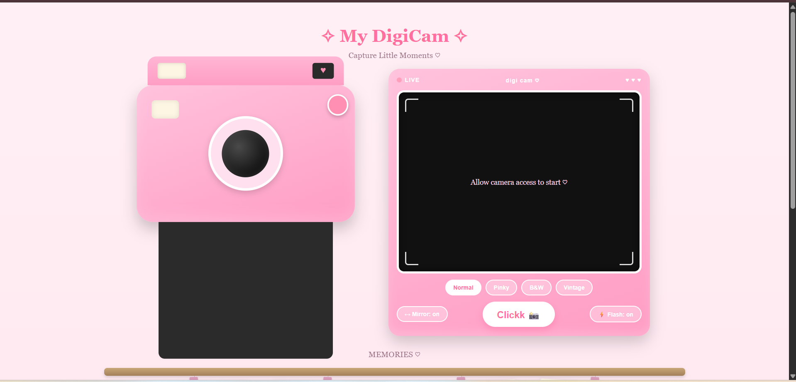
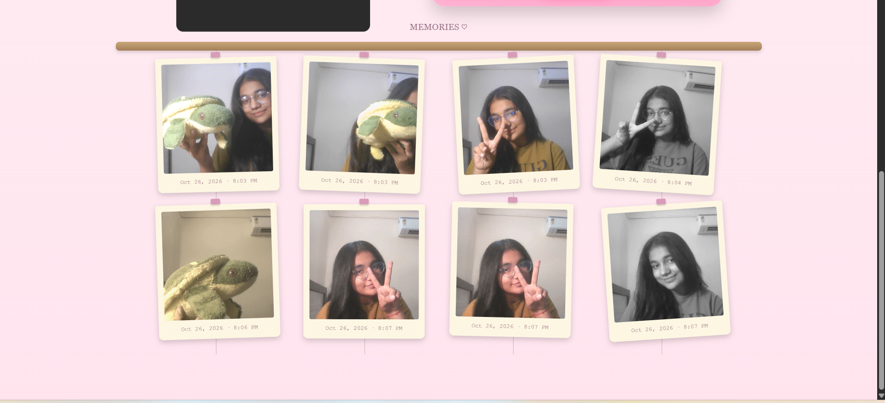
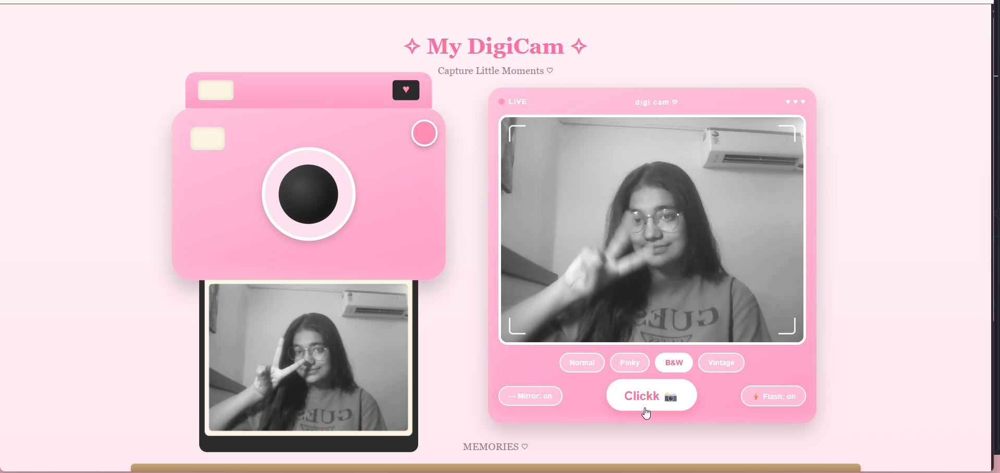

# 🎀 My DigiCam — A Digital Camera & Polaroid Experience

> Capture little moments, one click at a time. ♡

My DigiCam is a cute, pink-themed digital camera web application inspired by retro cameras and Polaroid photographs. It lets you capture photos using your device's camera, experiment with filters, and build your own little memory wall — all through a playful, interactive interface.

Built as part of my journey of learning JavaScript and exploring creative web development.
## 📸 Screenshots

### Main Camera Interface


### Memory Wall


### Photo Preview


## ✨ Features

📸 **Live Camera Preview**
- Access your device's camera through the browser.
- Capture photos directly from the live preview.

🎨 **Photo Filters**
- Normal
- Pinky
- Black & White
- Vintage

🪞 **Mirror Mode**
- Toggle the mirrored camera preview on or off.
- Captured photos reflect the selected mirror setting.

⚡ **Camera Flash Effect**
- Toggle the visual flash effect when capturing a photo.

🖼️ **Polaroid-Style Memory Wall**
- Display captured photos as hanging Polaroid-style prints.
- Add timestamps to your memories.
- Arrange photos with slightly randomized rotations for a scrapbook-like feel.

💾 **Local Photo Storage**
- Save captured photos in browser Local Storage.
- Restore saved photos when you revisit or refresh the page in the same browser storage context.
- Keep your memories available without a backend database.

⬇️ **Download & Delete**
- Open a saved photo to view its details.
- Download a photo as a PNG with a timestamp.
- Remove unwanted photos from your gallery.

🌸 **Cute, Interactive UI**
- Pastel pink gradients and a custom CSS camera illustration.
- Animated capture and photo-printing effects.
- A responsive layout designed to adapt to different screen sizes.

## 🛠️ Built With

- **HTML5** — page structure and camera interface
- **CSS3** — styling, gradients, animations, and visual effects
- **JavaScript** — camera interactions, filters, photo capture, gallery management, and event handling
- **Canvas API** — image capture, processing, and download generation
- **MediaDevices API** — accessing the device camera
- **Local Storage** — saving and restoring captured photos

## 🚀 Getting Started

### 1. Clone the repository

```bash
git clone https://github.com/divyav-tech/my-digicam.git
```

### 2. Open the project

Navigate to the project folder:

```bash
cd my-digicam
```

Open `index.html` using a local development server, such as the Live Server extension in Visual Studio Code.

### 3. Allow camera access

- Open the website in a supported browser.
- Grant camera permission when prompted.
- Click **Clickk 📸** to capture a photo.
- Experiment with the filters and explore your memory wall!

**Note:** Camera access generally requires HTTPS or a trusted local development environment such as `localhost`. Opening the HTML file directly may not support camera access in every browser.

## 📁 Project Structure

cute-cam/

index.html

style.css

js.js

README.md

screenshots/

camera-interface.png

memory-wall.png

photo-preview.png

## 🧠 What I Learned

Building Cute Cam helped me practise JavaScript beyond basic exercises and explore how browser features can be used to create interactive experiences.

Some of the concepts I worked with include:

- Accessing the browser's camera using `navigator.mediaDevices.getUserMedia()`.
- Handling button clicks and dynamically updating the DOM.
- Applying visual filters to a live video preview and captured images.
- Using the Canvas API to process and export images.
- Storing and retrieving data using `localStorage`.
- Dynamically generating gallery elements from saved photo data.
- Creating animations and transitions with CSS.
- Handling camera permission errors and basic storage failures.

## 🔒 Privacy & Limitations

- Camera access requires user permission.
- Captured photos are stored in the browser's Local Storage on the current origin.
- The project does not use a backend server or cloud photo storage.
- Clearing browser storage or site data can remove saved photos.
- Local Storage has limited capacity, so saving many photos may eventually cause storage errors.
- Camera availability depends on browser support, permissions, and the environment in which the website is hosted.

## 🌷 Future Improvements

Some ideas I'd love to explore next:

- Add more filters and photo effects.
- Introduce customizable Polaroid frames and captions.
- Improve photo organization and gallery controls.
- Explore additional camera controls where supported by the browser.

## 💗 A Little Note

Cute Cam is a personal learning project created to combine my interest in creative design with my growing JavaScript skills.

It's a reminder that learning to code doesn't always have to mean building something complicated — sometimes, it can mean turning a small, playful idea into something interactive and useful.

**Made with HTML, CSS, JavaScript, and a little bit of pink magic. ♡**
